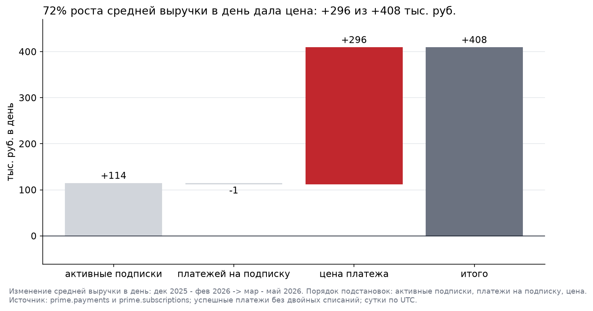
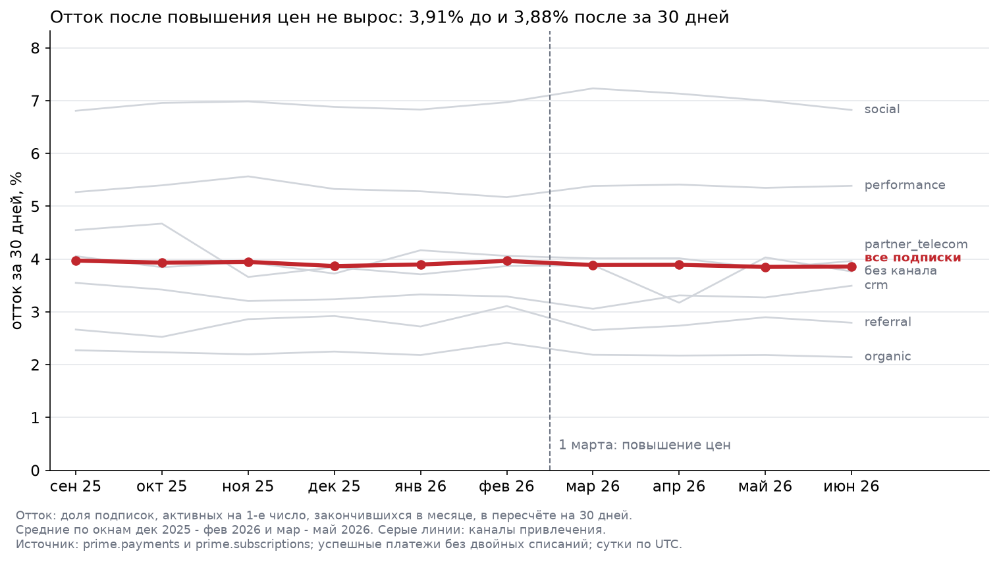

# Окупилось ли повышение цен в марте 2026?

**Автор:** Седых Владислав, группа БАЦРФ-1  
**Расчёт:** [`notebooks/project1.ipynb`](notebooks/project1.ipynb)  
**Данные:** база ПРАЙМ, сутки по UTC

**Вопрос.** 1 марта 2026 ПРАЙМ поднял цены подписки: "Базовый" с 199 до 249 руб. (+25,1%), "Расширенный" с 399 до 449 руб. (+12,5%).
Принесло ли это больше денег, или выигрыш съел отток? Что делать с ценами дальше?

**Коротко.** Повышение окупилось: средняя выручка в день выросла на 27%, из них почти три четверти дала цена.
Клиенты из-за цены не ушли: приведенный отток не изменился. Цены стоит оставить и следить за двумя платными каналами.

---

## 1. Что случилось?

Сравнили по 3 месяца до и после повышения: декабрь 2025 - февраль 2026 против марта - мая 2026, по 90 дней с данными.
Средняя выручка в день от подписок выросла с **1,51 до 1,92 млн руб.: +408 тыс. руб. в день, +27,1%**.
Скачок произошёл ровно в марте, в июне уровень держится (2,00 млн руб. в день).

## 2. За счёт чего?

Выручку в день разложили на три множителя: среднее число активных подписок × среднее число платежей на подписку в день × средняя цена платежа.

| Фактор | Влияние, тыс. руб. в день | % от роста итого |
|---|---:|---:|
| средняя цена платежа (274,82 -> 324,90 руб.) | **+296** | 72% |
| среднее число активных подписок (+7,5%) | +114 | 28% |
| среднее число платежей на подписку | -1 | 0% |
| **итого** | **+408** | 100% |

Порядок подстановок: сначала количество, потом цена. При любом из 6 порядков цена даёт больше чем вдвое против базы.
Клиенты не перешли на дешёвый тариф: доля "Расширенного" 37,9% до и после, эффект структуры +0,5 тыс. руб. в день.
Рост базы тот же, что до повышения: каждый месяц +31-44 тыс. руб. в день. Цена дала разовый скачок +289 тыс. руб. в день в марте.
**При нынешней базе повышение приносит около 8,9 млн руб. за 30 дней.**

## 3. Какие гипотезы проверяли?

| Гипотеза | Результат |
|---|---|
| 1. Рост выручки дала цена, а не база | **подтвердилась**: 72% роста |
| 2. После повышения вырос отток | **не подтвердилась**: семь проверок, ни одна не показала роста |
| 3. Сильнее ушли клиенты дешёвого тарифа или отдельных каналов | тариф: **нет**; каналы: **слабый сигнал** у `social` и `performance` |

Что именно проверили по оттоку (до -> после):

- приведенный отток за 30 дней: 3,91% -> 3,88%; у "Базового", где цена выросла сильнее, 3,95% -> 3,86%;
- новых подписок в день: 366 -> 360, в пределах обычных колебаний (354-369);
- отмены по дням вокруг 1 марта: 223 в день в феврале, 222 в первые две недели марта, всплеска нет;
- доля отмен с причиной "слишком дорого": 24,3% в феврале, 24,1% в марте;
- доля неудачных платежей: 3,29% -> 3,32%;
- ранний отток (ушли на первом продлении) у новых подписок: 4,12% -> 4,15%;
- единственный сигнал: у `social` приведенный отток 6,89% -> 7,12% (+0,23 п.п.), у `performance` 5,26% -> 5,38% (+0,12 п.п.).
  Все три месяца после повышения выше всех трёх до, но разница на грани шума.

**Приведенный отток** это доля подписок, активных на 1-е число, ушедшая за месяц, через средний дневной отток пересчитанная на 30 дней:
так февраль (28 дней) и март (31 день) можно сравнивать напрямую.

## 4. Что ещё нашли по дороге?

- **1 189 повторных успешных списаний на 363 тыс. руб.** у 1 185 подписок: повтор через 0-15 минут. Из выручки исключены.
  Ни один не возвращён. В базе возврат меняет статус самого платежа на `refunded` (отдельной строки возврата нет),
  поэтому проверяли статусы обоих платежей пары: пар "успешный, затем возвращён" нет ни одной.
  У всех пар оба платежа в одном статусе, даже у неудачных: это может быть и двойное списание, и техническое задвоение записи.
- **Строка 429 руб. в справочнике тарифов** пересекается с соседними, платежей по ней нет: ошибка ввода, исключена.
- **Дыра в выгрузке платежей 14-15 апреля 2026.** Подписки за эти дни на месте, поэтому отток не задет; выручку апреля считали по 28 дням.

## 5. Чего мы не знаем?

- **Долгий эффект.** После повышения есть данные за 4 месяца (март - июнь). Клиенты могут уходить позже, например не продлевать подписку через полгода.
- **Что было бы без повышения.** Контрольной группы нет: сравниваем с трендом до марта, а не с экспериментом.
- **Почему клиенты не отреагировали.** Разложение отвечает "за счёт чего", а не "почему": ценность подписки, отсутствие альтернатив или привычка.
- **Маржу.** Считали выручку; кэшбэк и выплаты партнёрам не вычитали.
- **Кто не подписался из-за цены.** Новых подписок столько же, но конверсию регистраций в подписку по новой цене мы не проверяли.

## 6. Что можно делать дальше?

| Действие | Кто |
|---|---|
| Оставить новые цены. Они дают около 296 тыс. руб. в день и не вызвали оттока | продукт, финансы |
| Ежемесячно смотреть приведенный отток в разрезе канала привлечения; если рост сохранится, необходимо будет принять решение | маркетинг, аналитика |
| Проверить с платёжной командой 1 185 подписок с повторными успешными списаниями: двойное списание это или задвоение записи; если двойное, вернуть 363 тыс. руб. и найти, почему шлюз повторяет запрос | платежи, поддержка |
| Запросить у владельца выгрузки платежи за 14-15.04.2026 и исправить строку 429 руб. в справочнике | данные |

## 7. Заключение

Повышение цен привело к значительному росту выручки и не привело к росту оттока, что является положительным сигналом.
Но глубина исследования недостаточна, так как после повышения цен есть данные всего за 4 месяца (март - июнь) и мы можем не наблюдать отложенный эффект. 
Сейчас цены можно оставить, так как ни в одном исследовании не было выявлено увеличения оттока, но необходимо поставить на мониторинг метрику "приведенного 30-дневного оттока клиента" и плавающим окном в 30 дней отток клиентов за период. 
Для дальнейшего решения по ценам необходимо обеспечить достаточную глубину исследования.

Текущее решение о повышении цен оценивается как эффективное по выручке на горизонте 4 месяцев.
